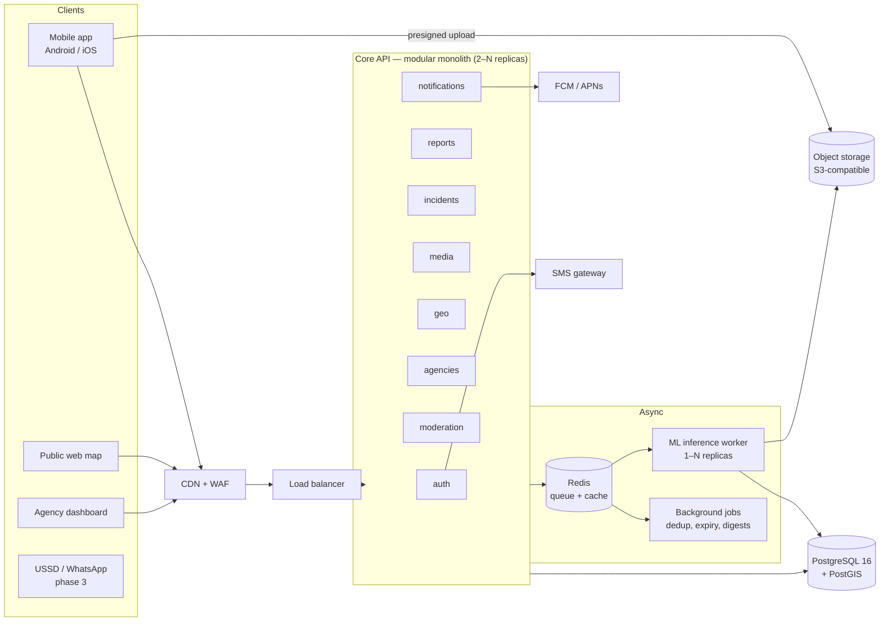
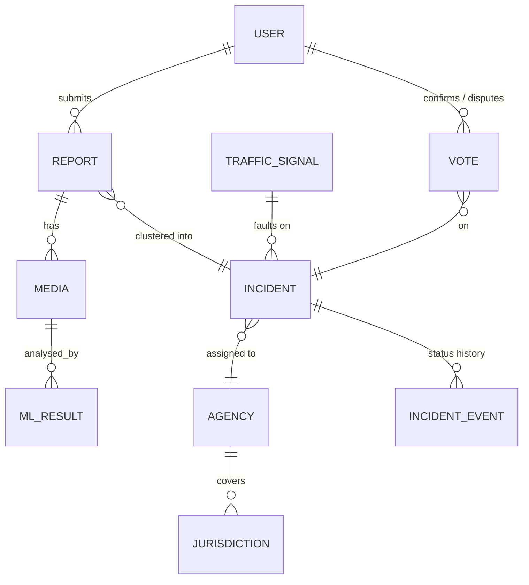

# Road Hazard Reporting Platform (v2) — Architecture Plan

> Status: **DRAFT for team review** · Supersedes the FYP prototype in this repo.
> Scope: a national, citizen-facing platform for Ghana to report and track
> potholes, faulty traffic lights, and other serious road hazards.

---

## 1. What we are building

| Capability | Description |
|---|---|
| **Pothole reporting (AI-assisted)** | User takes a photo; an ML model confirms a pothole, estimates size/severity, and the report is pinned to the exact GPS location. |
| **Faulty traffic light reporting** | User picks the junction (snapped to known traffic-light locations) and the fault type: *all lights out, stuck on red, flashing, wrong phase, damaged/knocked-down pole*. |
| **General road hazard reporting** | Broken-down vehicle in a dangerous spot, accident, debris/fallen tree, flooding, missing manhole/drain cover, oil spill, missing/damaged road sign, collapsed culvert/bridge edge, pedestrian hazards (open drains, broken walkways). |
| **Live hazard map** | Public map of active incidents, filterable by type, severity, region. |
| **Nearby alerts** | Drivers/pedestrians get notified of severe hazards on or near their route. |
| **Authority dashboard** | Agencies (road authorities, MMDAs, police) see incidents in *their* jurisdiction, assign, update status, and close them. |
| **Feedback loop** | Reporters are notified when their report is acknowledged/fixed. Verified photos feed back into model training. |

### Non-functional targets

| Target | Value |
|---|---|
| Concurrent users (launch) | **≥ 200**, designed and load-tested for **2,000** (10× headroom) |
| Report submission latency (API ack) | p95 < 500 ms (ML runs asynchronously) |
| ML verdict on a photo | p95 < 10 s after upload |
| Map/list API | p95 < 300 ms |
| Availability | 99.5% to start, 99.9% later |
| Works on | Low-end Android over 3G, intermittent connectivity (offline queueing) |
| Data protection | Ghana **Data Protection Act, 2012 (Act 843)** — register with the Data Protection Commission; blur faces & number plates |

---

## 2. Monolith vs microservices — decision

**Decision: a _modular monolith_ for the core API, plus a _separate ML inference
worker_. Not full microservices.**

### Why not microservices (yet)

- **The load does not need it.** 200 concurrent users is roughly 20–60 requests/second
  (see §7). One well-built API process handles hundreds of req/s, and two or three
  replicas behind a load balancer give redundancy and 10× headroom.
- **A small team pays a large tax with microservices:** service-to-service auth,
  distributed tracing, network failures between services, separate deploy pipelines,
  data consistency across databases. That is time taken away from the ML model and the product.
- **Our domain is tightly coupled.** A report, its incident, its media, its
  moderation status, and its agency assignment are all read together. Splitting
  them across services would mean many cross-service calls.

### Why the ML worker *is* separate

- It has a **completely different resource profile**: CPU/GPU-heavy, large memory
  (model weights), slow (seconds) vs. the API (I/O-bound, milliseconds).
- It must **scale independently.** A burst of photo uploads should not slow down map
  browsing.
- It lets us **ship new model versions** without redeploying the API.
- If it crashes or falls behind, reports are still accepted and queued (graceful degradation).

### "Modular" means

The monolith is split internally into modules with clear boundaries
(`auth`, `reports`, `incidents`, `media`, `geo`, `agencies`, `notifications`,
`moderation`). Modules talk through Python interfaces and domain events, **never by
reaching into each other's tables**. If one module later needs to become its own
service (most likely `notifications` or `geo`), we can extract it without a rewrite.

---

## 3. High-level architecture



### Life of a pothole report

1. App takes a photo **in-app only** (no gallery uploads for hazards; this reduces fake
   reports) and captures GPS + accuracy + heading + timestamp.
2. App calls `POST /reports/uploads` → API returns a **presigned upload URL**. The app
   uploads the image **directly to object storage** (the API never handles image bytes,
   which is the main thing that lets it scale).
3. App calls `POST /reports` with metadata + media key. API validates (inside Ghana,
   GPS accuracy acceptable, rate limits), stores the report as `PENDING_ANALYSIS`, publishes a
   job, returns `202 Accepted` in under 500 ms.
4. ML worker pulls the job, runs detection, writes results (boxes, class, confidence,
   estimated severity), blurs faces/plates, and creates the public thumbnail.
5. The **dedup/clustering** job attaches the report to an existing nearby **incident**
   of the same type, or opens a new one.
6. The incident is routed to the responsible **agency** by jurisdiction polygon.
7. The reporter gets a push notification: *"Pothole confirmed. Sent to <Agency>."*

Traffic-light and other-hazard reports follow the same flow. The ML step is optional
for them: run a general classifier for plausibility checks and image moderation.

---

## 4. Core domain model

The key idea is **separating *reports* (what one citizen sent) from *incidents*
(the real-world problem)**. Ten people reporting the same pothole should create
**one incident with ten confirmations**, not ten tickets.



| Entity | Key fields |
|---|---|
| `users` | id, phone (verified), display_name, role (`citizen`, `moderator`, `agency_staff`, `admin`), agency_id, trust_score |
| `reports` | id, user_id, category, subtype, description, `location geography(Point)`, gps_accuracy_m, heading, captured_at, device_info, status, incident_id |
| `media` | id, report_id, storage_key, blurred_key, thumb_key, sha256, width/height, exif_ok |
| `ml_results` | media_id, model_name, model_version, detections JSONB, top_confidence, severity_estimate, latency_ms |
| `incidents` | id, category, subtype, severity (1–5), status, `location`, road_name, region/district, agency_id, report_count, first/last_reported_at, expires_at, resolved_at |
| `incident_events` | incident_id, actor_id, from_status, to_status, note, created_at (full audit trail) |
| `agencies` | id, name, type (`GHA`, `DUR`, `DFR`, `MMDA`, `MTTD`, `NADMO`, …), contact channels |
| `jurisdictions` | agency_id, category scope, `area geography(MultiPolygon)` |
| `traffic_signals` | id, junction_name, `location`, owner agency (seeded from OSM `highway=traffic_signals` + agency data) |
| `votes` | user_id, incident_id, kind (`still_there`, `fixed`, `not_real`) |

### Hazard categories (v1 list, configurable in DB)

| Category | Subtypes | Default lifetime |
|---|---|---|
| `pothole` | small, large, cluster, road collapse | until resolved |
| `traffic_signal` | all out, stuck red, flashing, wrong phase, damaged pole | until resolved |
| `obstruction` | broken-down vehicle, debris, fallen tree, abandoned vehicle | **auto-expire 6 h** unless re-confirmed |
| `accident` | collision, overturned vehicle | auto-expire 3 h |
| `flooding` | road flooded, washed-out section | auto-expire 24 h |
| `infrastructure` | missing manhole/drain cover, damaged guardrail, missing sign, broken streetlight, collapsed culvert | until resolved |
| `pedestrian` | open drain on walkway, broken footbridge, blocked sidewalk | until resolved |

Transient hazards (broken-down vehicles, accidents) **must expire**. Otherwise the map
fills up with stale warnings and people stop trusting it.

### Incident lifecycle

```
REPORTED → VERIFIED → ASSIGNED → IN_PROGRESS → RESOLVED → CLOSED
     ↘ REJECTED (spam/duplicate/not a hazard)      ↘ REOPENED (citizens say "still there")
```

### Deduplication rule (starting point, tune with data)

Attach a new report to an existing open incident if it has the **same category**, is
**within N metres** (pothole 15 m, traffic signal: same junction, obstruction 50 m,
flooding 150 m), and the incident is still active. Implemented with
`ST_DWithin` on PostGIS GiST indexes, so it is a fast query.

---

## 5. Tech stack

| Layer | Choice | Why |
|---|---|---|
| **Core API** | **Python 3.12 + FastAPI**, SQLAlchemy 2 (async) + Alembic, Pydantic v2 | Team already knows it; same language as ML; async handles I/O-bound load well; auto OpenAPI docs. |
| **Database** | **PostgreSQL 16 + PostGIS** (managed) | Best open-source geospatial DB; we already use it. `ST_DWithin`, clustering, polygons for jurisdictions. |
| **Cache / queue / rate limit** | **Redis 7** | One component for job queue, caching hot map tiles/queries, rate limiting, and pub/sub for live updates. |
| **Background jobs** | **Celery** (or arq) on Redis | Mature retries, scheduling (expiry, digests), separate queues for `ml` vs `default`. |
| **Object storage** | S3-compatible (AWS S3 / Cloudflare R2 / Supabase Storage) | Presigned direct uploads; cheap; CDN-friendly. |
| **ML training** | PyTorch, experiment tracking with **MLflow** (or W&B), data versioning with **DVC** | Reproducible training; compare model versions properly. |
| **ML serving** | Export to **ONNX**, run with **ONNX Runtime** in the worker (CPU first; GPU if needed) | Faster and lighter than raw PyTorch, no heavy training deps in production. |
| **Mobile app** | **React Native (Expo) + TypeScript** | One codebase for Android and iOS; shares language and types with the web dashboard; offline storage; OTA updates. *(Flutter is an equally good choice if the team prefers Dart.)* |
| **Web (public map + agency dashboard)** | **Next.js + TypeScript**, **MapLibre GL** | MapLibre + OpenStreetMap tiles avoids Google Maps per-load costs at national scale. |
| **Auth** | Phone number + **SMS OTP** (local gateway, e.g. Hubtel / Arkesel / mNotify), JWT access + refresh tokens; agency staff get email + password + 2FA | Phone-first suits Ghana; ties accounts to a real SIM, which deters spam. |
| **Push notifications** | Firebase Cloud Messaging (Android + iOS) | Free; standard. |
| **Infra** | Docker everywhere; **Docker Compose** for dev; a managed container platform for prod (AWS ECS/Fargate, Azure Container Apps, or Render/Fly to start). Kubernetes **only** if we outgrow it. | Avoid ops overhead early. |
| **IaC** | Terraform | Reproducible environments (staging = prod). |
| **CI/CD** | GitHub Actions: lint, type-check, tests, build images, deploy to staging on merge, manual promote to prod | |
| **Observability** | OpenTelemetry → Grafana (Prometheus/Loki/Tempo) or a hosted equivalent; **Sentry** for errors (API + mobile) | |
| **Load testing** | **k6** or Locust | Prove the 200/2,000 user target before launch. |

**Hosting region:** prefer the closest regions to Ghana for latency, e.g. AWS
`af-south-1` (Cape Town), Azure South Africa North, or a local Ghanaian data centre
if government partners require data residency. **Confirm residency requirements
with the Data Protection Commission and any government partner early.**

---

## 6. The ML model — doing it properly

The prototype was trained on **569 images** from one Roboflow set. That is the
biggest weakness to fix.

### 6.1 Data

| Source | Notes |
|---|---|
| **RDD2022** (Road Damage Detection, ~47k images from Japan, India, Czech Republic, Norway, USA, China) | Large, labelled; includes potholes (D40) and cracks (D00/D10/D20). Good for pre-training. Check its licence terms before use. |
| Public pothole sets (Roboflow Universe, Kaggle pothole datasets, Pothole-600, etc.) | Combine and **de-duplicate** (many are copies of each other). |
| **Our own Ghana data (most important)** | Models trained abroad struggle with local conditions: laterite/untarred roads, different lighting, dust, rain, local vehicles. Run a **structured collection drive**: dashcam/phone video across regions, urban + rural, dry + rainy season, day + dusk. Extract frames, label them. |
| **Production feedback** | Every moderator-verified report becomes a new labelled example (**active learning**). Prioritise labelling images the model was *unsure* about. |

**Labelling:** CVAT or Label Studio (self-hosted, free). Write a labelling guide
(what counts as a pothole vs. a crack vs. a patch) so labels are consistent, and
double-label 10% to measure agreement.

**Splits:** split **by location/road**, not by random image. Otherwise frames from
the same video end up in both train and test and the scores look better than they are.
Keep a fixed **Ghana-only test set** that is never trained on. That is the number we report.

### 6.2 Model

- **Task:** object detection (+ optionally instance segmentation for area estimate →
  severity). Classes v1: `pothole`, `crack_longitudinal`, `crack_transverse`,
  `crack_alligator`, `patch` (patches help the model avoid confusing repaired spots with potholes).
- **Candidates to benchmark:** YOLO-family (YOLOv8/YOLO11), **RT-DETR**, **RF-DETR**, **D-FINE**.
  Pick by accuracy on *our Ghana test set* vs. CPU latency.
- **⚠️ Licensing:** Ultralytics YOLO is **AGPL-3.0**. For a national/government system
  that is not fully open-sourced, that requires either open-sourcing the whole service
  or buying an Ultralytics enterprise licence. RT-DETR, RF-DETR, and D-FINE have
  Apache-2.0 implementations. **Decide this before we invest in training.**
- **Recipe:** pre-train on RDD2022 + public sets → fine-tune on Ghana data → heavy
  augmentation (motion blur, rain, low light, JPEG compression, phone-camera noise).
- **Severity estimate:** box/mask area relative to image + estimated distance, mapped
  to 1–5; later calibrated against agency field assessments.

### 6.3 Targets & evaluation

| Metric (on Ghana test set) | Target for launch |
|---|---|
| Pothole **recall** @ IoU 0.5 | ≥ 0.85 (missing real potholes is the worse failure) |
| Pothole **precision** @ IoU 0.5 | ≥ 0.80 |
| mAP@0.5:0.95 | track and report; improve each release |
| CPU inference (ONNX, 640px) | < 300 ms per image |

Report metrics **per condition** (paved/unpaved, day/night, wet/dry) so we know where it fails.

### 6.4 MLOps

- Every model has a version, training-data hash (DVC), metrics, and model card in MLflow.
- **Shadow deployment:** a new model runs alongside the current one on live traffic,
  results are compared, then it is promoted.
- Worker records `model_version` with every prediction, so results can be audited and re-run.
- Monitor drift: confidence distribution and moderator-override rate per week.

### 6.5 Optional (phase 3): on-device model

A small TFLite/CoreML model in the app gives instant *"we see a pothole"* feedback and
could support **passive dashcam mode** (phone on the dashboard, auto-detect while
driving). The server model remains the source of truth.

---

## 7. Capacity plan — 200 concurrent users (and 10×)

**Assumptions (pessimistic):** each active user makes 1 API call every 5 s while
browsing the map; 10% of active users submit a report per minute at peak.

| | 200 users | 2,000 users |
|---|---|---|
| API requests/s | ~40 | ~400 |
| Reports/min | ~20 | ~200 |
| Photo uploads | go **straight to object storage**, not through API | same |
| ML jobs/s | ~0.3 | ~3.3 |

**Sizing that covers 2,000 users:**

| Component | Size |
|---|---|
| Core API | 3 replicas × (2 vCPU, 2 GB), Uvicorn/Gunicorn with 4 workers each. Autoscale on CPU. |
| ML worker | 2 replicas × (4 vCPU, 8 GB) on CPU ONNX at ~300 ms/image ≈ 25 img/s capacity. Add a GPU node only if needed. |
| PostgreSQL | Managed, 4 vCPU / 16 GB, PgBouncer connection pooling, daily backups + point-in-time recovery, 1 read replica later. |
| Redis | Managed, 1–2 GB. |

**What keeps it fast:**
- Images never pass through the API (presigned uploads).
- ML is async through a queue, so bursts are absorbed and nothing times out.
- Map queries use a **bounding-box + zoom** API with server-side clustering, cached in
  Redis for a few seconds; vector tiles later if needed.
- PostGIS GiST indexes on all geography columns; connection pooling.
- CDN in front of public map data and thumbnails.
- API is **stateless**, so we scale by adding replicas.

**Proof:** a k6 load test simulating 2,000 virtual users (browse map + submit reports)
must pass p95 targets on staging **before launch**.

---

## 8. Trust, safety, and abuse prevention

A national platform *will* get spam, pranks, and duplicate reports. Defences:

1. **Phone-verified accounts** (OTP) and per-user + per-IP **rate limits** (e.g. max 10 reports/hour).
2. **Live-camera-only capture** for photo reports; check EXIF/time/GPS consistency.
3. **Location sanity:** within Ghana; GPS accuracy ≤ 50 m (or ask user to confirm pin);
   reporter's device location must be near the hazard at capture time.
4. **ML plausibility gate:** pothole reports with no detected pothole go to the moderation
   queue instead of the public map.
5. **Image moderation:** reject NSFW/irrelevant images automatically.
6. **Privacy blurring:** faces and number plates blurred before any image is public (ML worker).
7. **Trust score:** users whose reports are verified gain trust (auto-publish); repeated
   rejects lower it (more moderation).
8. **Community confirmation:** "Still there" / "Fixed" / "Not real" votes from nearby users.
9. **Audit log** for every status change by agency staff/moderators.

---

## 9. Security baseline

- TLS everywhere; HSTS; WAF/CDN in front (Cloudflare or cloud equivalent).
- JWT (short-lived access, rotating refresh); RBAC by role + agency + jurisdiction.
- Agency/admin accounts: 2FA mandatory.
- Secrets in a secrets manager, never in the repo (the prototype once tracked `.env`).
- Presigned URLs: short expiry, content-type + size limits, scanned on arrival.
- OWASP ASVS L2 as the checklist; dependency scanning (Dependabot) and SAST in CI.
- Personal data minimised: public views never show reporter identity or phone.
- Backups encrypted; restore tested quarterly.

---

## 10. API surface (v1 sketch)

```
POST   /v1/auth/otp/request          {phone}
POST   /v1/auth/otp/verify           {phone, code} → tokens
POST   /v1/auth/refresh

GET    /v1/categories                hazard categories + subtypes (drives app UI)
POST   /v1/uploads                   → presigned URL + media key
POST   /v1/reports                   create report (202 Accepted)
GET    /v1/reports/me                my reports + status

GET    /v1/incidents?bbox=&zoom=&category=&status=   map query (clustered)
GET    /v1/incidents/{id}
POST   /v1/incidents/{id}/votes      still_there | fixed | not_real
GET    /v1/traffic-signals?bbox=     known signal locations for the picker

GET    /v1/alerts/nearby?lat=&lng=&radius=           severe hazards near me
WS     /v1/live?bbox=                live incident updates (phase 2)

# Agency / moderator (RBAC)
GET    /v1/agency/incidents?status=&assigned_to=
PATCH  /v1/agency/incidents/{id}     status, assignee, note
GET    /v1/agency/stats              counts, time-to-resolve, hotspots
GET    /v1/moderation/queue
POST   /v1/moderation/{report_id}    approve | reject | merge
```

---

## 11. Repository layout (new monorepo)

```
road-hazard-platform/
├── apps/
│   ├── api/                 FastAPI modular monolith
│   │   └── src/rh/
│   │       ├── modules/{auth,reports,incidents,media,geo,agencies,moderation,notifications}/
│   │       │       each: api.py, service.py, models.py, schemas.py, events.py
│   │       ├── core/        config, db, security, events bus
│   │       └── workers/     Celery tasks (dedup, expiry, notifications)
│   ├── ml-worker/           inference worker (ONNX Runtime, blurring)
│   ├── mobile/              React Native (Expo)
│   └── web/                 Next.js public map + agency dashboard
├── ml/
│   ├── data/                DVC-tracked dataset definitions (not raw images)
│   ├── training/            training + evaluation scripts, configs
│   ├── export/              ONNX export + benchmark
│   └── model-cards/
├── packages/
│   └── api-client/          TypeScript client generated from OpenAPI (shared by mobile + web)
├── infra/
│   ├── docker/              Dockerfiles, docker-compose.yml for local dev
│   └── terraform/
├── load-tests/              k6 scripts
├── docs/                    architecture, ADRs, runbooks
└── .github/workflows/
```

---

## 12. Roadmap

| Phase | Duration (estimate) | Deliverables |
|---|---|---|
| **0. Foundations** | 2–3 wks | Finalise this doc + ADRs; licence decision for ML; monorepo, CI, Docker Compose dev env; DB schema + migrations; auth (OTP). Start **Ghana data collection** in parallel. |
| **1. MVP core** | 6–8 wks | Report flow (all 3 categories) with presigned uploads; incidents + dedup; public map; ML worker with an interim model trained on public data; basic moderation; Android app beta. |
| **2. Model v1 + agencies** | 6–8 wks | Model trained on public + Ghana data meeting §6.3 targets; agency dashboard with jurisdictions + routing; notifications; face/plate blurring; k6 load test passing; security review; pilot in **one metro** (e.g. Accra or Kumasi) with one partner agency. |
| **3. National rollout** | ongoing | iOS app; nearby alerts + live updates; USSD/WhatsApp reporting for feature phones; more regions/agencies; active-learning retraining every release; public open-data API/analytics. |

---

## 13. Open questions for the team

1. **Partners:** Which agencies will we pilot with (Ghana Highway Authority, Department
   of Urban Roads, Department of Feeder Roads, an MMDA, Police MTTD, NADMO)? Their
   buy-in decides whether reports actually get fixed, and it matters more than the tech.
2. **ML licence:** open-source the whole platform (AGPL is fine) or keep it closed
   (use an Apache-2.0 model like RT-DETR/RF-DETR, or buy an Ultralytics licence)?
3. **Mobile framework:** React Native (recommended, shares TypeScript with web) or Flutter?
4. **Hosting & data residency:** any government requirement to host in Ghana?
5. **Budget:** cloud budget per month determines CPU-only vs. GPU inference and managed vs. self-hosted services.
6. **Anonymous reporting:** allow it (more reports, more spam) or require phone verification (recommended)?
7. **Addresses:** integrate GhanaPostGPS digital addresses in reports (needs API access)?

---

*Next step after review: record each decision as an ADR in `docs/v2/adr/` and start
Phase 0.*
