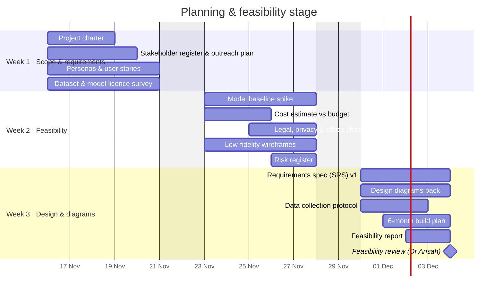

# Planning & Feasibility Stage (3 weeks)

**Dates:** Mon 16 Nov 2026 → Fri 4 Dec 2026
**Ends with:** a feasibility review with Dr Prince Ansah (Department of Computer Science, University of Ghana), where we decide go / adjust / stop before the 6-month build starts.

This stage turns the funding proposal into a plan we can actually build. Everything here must stay within what the proposal commits to:

| Proposal commitment | Value |
|---|---|
| Budget | **GHS 60,000**, no stipends |
| Duration | **6 months** |
| Team | Kelly Buabeng (team lead, backend, PM), Nathaniel Addo (AI/ML), Seth Akoto (frontend, UX) |
| Product | Android app for 3 hazard types (pothole, faulty traffic light, other hazard), public map, authority dashboard, retrained AI model |
| Pilot | University of Ghana community, with the UG Department of Computer Science |
| Authorities to onboard | National Road Safety Authority (NRSA), MTTD (Ghana Police Service), Ministry of Transport |
| Success targets | ≥ 85% pothole recall on Ghana test photos · tested for ≥ 200 users at once · pilot running · ≥ 1 national authority has seen a demo and agreed next steps |

---

## Schedule

---

## Deliverables

Status: ⬜ not started · 🟨 draft in repo · ✅ reviewed by the team

### Week 1 — Scope & requirements (16–20 Nov)

| # | Deliverable | Owner | File | Status |
|---|---|---|---|---|
| 1 | **Project charter**: scope, objectives, constraints, what is out of scope | Kelly | [01-project-charter.md](01-project-charter.md) | 🟨 |
| 2 | **Stakeholder register & outreach plan**: who we need, what we ask, when | Kelly | [02-stakeholders.md](02-stakeholders.md) | 🟨 |
| 3 | **Personas & user stories** with priorities | Seth | [03-requirements.md](03-requirements.md) | 🟨 |
| 4 | **Dataset & model licence survey**: RDD2022 and other sets (size, classes, licence); YOLO (AGPL) vs RT-DETR / RF-DETR (Apache-2.0) | Nathaniel | `04-dataset-survey.md` | ⬜ |

**End of week 1:** a 30-minute team check. Is the scope still right for GHS 60k and 6 months?

### Week 2 — Feasibility (23–27 Nov)

| # | Deliverable | Owner | File | Status |
|---|---|---|---|---|
| 5 | **Technical feasibility spike**: train 2 candidate models on a subset of public data; measure accuracy and CPU speed; time the current prototype's `/detect` | Nathaniel | `05-technical-feasibility.md` | ⬜ |
| 6 | **Economic feasibility**: monthly cloud, GPU training, SMS and app-store costs against the budget lines (GHS 16,000 cloud, GHS 4,000 accounts/SMS) | Kelly | `06-cost-estimate.md` | ⬜ |
| 7 | **Legal, privacy & ethics**: Data Protection Commission registration steps; UG ethics needs for collecting road photos; face/plate blurring | Kelly | `07-legal-privacy.md` | ⬜ |
| 8 | **Low-fidelity wireframes**: report flow for each hazard type, map, "my reports", authority dashboard | Seth | `08-wireframes.md` (+ images) | ⬜ |
| 9 | **Risk register**: likelihood, impact, owner, mitigation | Kelly | `09-risk-register.md` | ⬜ |

### Week 3 — Design & diagrams (30 Nov–4 Dec)

| # | Deliverable | Owner | File | Status |
|---|---|---|---|---|
| 10 | **Requirements spec (SRS) v1**: user stories become numbered functional and non-functional requirements with acceptance criteria | Seth + Kelly | `10-srs.md` | ⬜ |
| 11 | **Design diagrams pack** (see list below) | Kelly (+ all) | `11-diagrams.md` | ⬜ |
| 12 | **Data collection protocol & labelling guide v1**: routes, devices, photo rules, label definitions | Nathaniel | `12-data-protocol.md` | ⬜ |
| 13 | **6-month build plan**: two-week sprints, milestones, budget burn per month | Kelly | `13-build-plan.md` | ⬜ |
| 14 | **Feasibility report**: summary of 5–9 and a go / adjust / stop recommendation | Kelly | `14-feasibility-report.md` | ⬜ |

### Diagrams pack (deliverable 11)

Already drafted: the [architecture page](../ARCHITECTURE.md), plus the interactive diagram page (system overview, report sequence, incident lifecycle, deployment, ML loop). The pack adds the standard design diagrams supervisors and authorities expect:

| Diagram | Shows | Owner |
|---|---|---|
| Context diagram (C4 level 1) | The system, its users and the outside systems it talks to | Kelly |
| Container diagram (C4 level 2) | App, API, workers, databases (simplify the existing overview) | Kelly |
| Use case diagram | What each actor (citizen, authority officer, moderator, admin) can do | Seth |
| User flow diagrams | Screen-by-screen path for each of the 3 report types | Seth |
| Entity-relationship diagram | Tables and relationships (start from §4 of the architecture doc) | Kelly |
| Sequence diagrams | Submit a report · authority resolves an incident · phone login | Kelly |
| State diagram | Incident lifecycle (already drafted) | Kelly |
| Deployment diagram | Revised to fit the GHS 16,000 cloud budget | Kelly |
| ML pipeline diagram | Data → labels → training → evaluation → deployment | Nathaniel |

All diagrams go into the repo as Mermaid (GitHub renders it) so anyone can edit them.

---

## How we work in this stage

- Every deliverable is a Markdown file in this folder on the working branch. "Shared" means pushed and linked in the table above.
- Update the status column when a draft is pushed (🟨) and again after someone else has reviewed it (✅).
- Short team check-ins on **Mondays and Thursdays**; the week-3 Friday review is with Dr Ansah.
- Decisions that change scope or budget go in `decisions.md` with the date and reason.

## Decisions this stage must make

1. **AI model and licence.** YOLO (AGPL-3.0) or an Apache-2.0 model? Decided after deliverables 4 and 5.
2. **Mobile framework.** React Native (Expo) or Flutter? The proposal promises Android only, so either works. Decide in week 1.
3. **Hosting.** Which provider fits GHS ~2,650/month (GHS 16,000 over 6 months)? Decided after deliverable 6.
4. **Pilot design.** Which UG roads and junctions, how many testers, and for how long? Decided with Dr Ansah.
5. **Authority asks.** What exactly do we ask NRSA, MTTD and the Ministry for in the first meeting? See deliverable 2.
