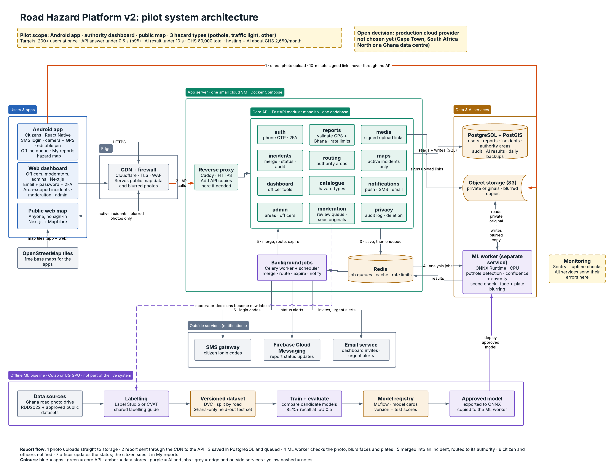

# System Architecture (v2 pilot)

**Editable source (Lucidchart):** [Road Hazard Platform v2 – System Architecture](https://lucid.app/lucidchart/e4637838-3441-4618-8e6c-2df11f5b8da2/edit?page=-p7ODkctAzHU)
This PNG is an export. Make changes in Lucidchart, then re-export and replace `system-architecture.png`.

**Scope:** the funded 6-month pilot (GHS 60,000): Android app, authority dashboard, public map, three hazard types, pilot with the University of Ghana community. Full design: [`../ARCHITECTURE.md`](../ARCHITECTURE.md).

## What the diagram shows

| Group | Parts |
|---|---|
| Users & apps | Android app (citizens), web dashboard (officers, moderators, admins), public web map |
| Edge | Cloudflare CDN + firewall: TLS, serves public map data and blurred photos |
| App server (one small VM, Docker Compose) | Caddy reverse proxy; Core API (FastAPI modular monolith, 12 sections); background jobs (Celery); Redis |
| Data & AI services | PostgreSQL + PostGIS, object storage (S3), ML worker (separate service, ONNX Runtime on CPU) |
| Outside services | SMS gateway, Firebase Cloud Messaging, email service, OpenStreetMap tiles |
| Offline ML pipeline | Data sources → labelling → versioned dataset → train + evaluate → model registry → approved model |

The 12 Core API sections match the functional requirement areas in [`../planning/10-functional-requirements.md`](../planning/10-functional-requirements.md).

## Report flow (numbers on the diagram)

1. The photo uploads straight to object storage with a 10-minute signed link, never through the API.
2. The report is sent through the CDN and proxy to the API.
3. The API saves it in PostgreSQL and queues an analysis job in Redis.
4. The ML worker checks the photo, reads the private original and writes a blurred copy.
5. Background jobs merge the report into an incident and route it to its authority.
6. The citizen and officers are notified (SMS, push, email).
7. The officer updates the status; the citizen sees it in My reports.

## Notes on the diagram

- **Open decision:** the production cloud provider has not been chosen (Cape Town, South Africa North or a Ghana data centre).
- **Targets:** 200+ users at once, API answer under 0.5 s (p95), AI result under 10 s, hosting + AI about GHS 2,650/month.
- **Monitoring:** every service sends its errors to Sentry, and uptime checks run on the public endpoints.
- **Privacy:** only moderators and admins see original photos. Everyone else sees blurred copies.
